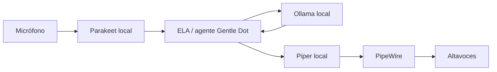

<a id="top"></a>

<div align="center">


<h1>ELA — Local AI Desktop Assistant</h1>

<p><strong>Un asistente personal de escritorio para Linux: IA local, voz y activación en segundo plano.</strong></p>

<p>


<a href="LICENSE"></a>
</p>

<p><strong>ELA es un fork comunitario independiente, desarrollado a partir de <a href="https://github.com/Gentleman-Programming/gentle-dot">Gentle Dot</a>.</strong> Conserva el ejecutable <code>gentle-dot</code> y las rutas de datos compatibles con el proyecto base.</p>

</div>

> [!WARNING]
> ELA sigue en desarrollo. Revisa las solicitudes del Agente completo antes de aprobarlas y valida micrófono, salida de audio, permisos y atajos en tu propia sesión gráfica. ELA no es una versión oficial de Gentle Dot.

## Características

- **Ollama local y optativo.** Conecta modelos ya instalados mediante la API compatible con OpenAI de Ollama. `qwen2.5:3b` es un modelo de inicio probado para conversación en español; no requiere una API key comercial. ELA no inicia Ollama, descarga modelos ni cambia a un proveedor remoto automáticamente.
- **Reconocimiento local con Parakeet.** La aplicación de escritorio incluye el modelo NVIDIA Parakeet TDT 0.6B v3 int8 mediante sherpa-onnx. El modelo se descarga desde el panel de voz cuando se solicita; no se incluye en Git.
- **Síntesis local con Piper.** Configura el binario y un modelo Piper existente. Daniela puede usarse como ejemplo si tienes sus archivos compatibles; las voces no se distribuyen con ELA.
- **Voice Mode en segundo plano.** Inicia una pregunta por voz sin abrir ni enfocar el panel y escucha la respuesta por PipeWire.
- **Voz Rápida para Voice Mode.** Usa un prompt compacto, el proveedor/modelo que elegiste y hasta ocho mensajes recientes de texto. No dispone de herramientas de ejecución.
- **Agente completo para el chat escrito.** Mantiene las herramientas habilitadas según la configuración y conserva sus aprobaciones y controles de seguridad.
- **Historial persistente.** Las conversaciones se guardan en el almacenamiento de Gentle Dot. La persistencia del historial no significa que el modelo recuerde semánticamente todos sus detalles en cada solicitud.
- **Tema azul eléctrico.** Interfaz oscura con acento azul, conservando la rosa original de Gentle Dot.
- **Linux y Hyprland/Wayland.** Incluye configuración de referencia para Omarchy/Hyprland Lua y para `hyprland.conf` clásico.

Las funciones nativas de control del escritorio tienen capacidades distintas en Linux y macOS. El control de escritorio de macOS del proyecto base no debe interpretarse como una función equivalente ya validada en todas las distribuciones Linux.

## Arquitectura de voz



Voice Mode utiliza la ruta rápida sin herramientas de ejecución. El chat escrito puede continuar usando el Agente completo, con herramientas y aprobaciones existentes.

## Instalación desde código en Arch Linux

### Requisitos

El instalador de Arch del repositorio comprueba e instala, con confirmación, las dependencias de sistema para Tauri y WebKitGTK. También prepara Node.js 24 y Rust estable 1.90 o posterior cuando hacen falta. `pnpm` se obtiene usando la versión fijada por `package.json` (11.5.0 en esta rama).

Ollama, Piper y sus modelos son componentes opcionales que se instalan por separado. Para la ruta de voz local también necesitas FFmpeg y PipeWire con `pw-play`. Para compilar y ejecutar desde código fuente necesitas conexión a Internet para clonar el repositorio y descargar dependencias. El reconocimiento/síntesis y la inferencia pueden ejecutarse localmente una vez que sus modelos estén instalados.

### Instalar la aplicación de escritorio

```sh
git clone --branch ela https://github.com/4k4m1m3-org/gentle-dot.git
cd gentle-dot
scripts/linux/setup-arch.sh
```

El script puede pedir `sudo` para los paquetes del sistema, instala las dependencias JavaScript, compila la interfaz y el daemon, compila Tauri sin bundle e instala un lanzador en `$HOME/.local/bin/gentle-dot`. Con `--no-launch` termina sin ofrecer iniciar la aplicación:

```sh
scripts/linux/setup-arch.sh --no-launch
```

Para trabajar en modo desarrollo web/daemon, en lugar de compilar el ejecutable de escritorio:

```sh
pnpm install --frozen-lockfile
pnpm typecheck
pnpm build
pnpm dev
```

`pnpm dev` inicia el daemon local y la interfaz de desarrollo. Mantén privada la URL de acceso que pueda imprimir el daemon; no la publiques junto con registros o capturas.

Para ejecutar también el shell de escritorio durante el desarrollo, usa `pnpm --filter @gentle-dot/desktop dev` en vez de `pnpm dev`.

## Configurar Ollama

Instala Ollama con las instrucciones de su [proyecto oficial](https://ollama.com/download), inicia el servidor local si aún no está activo y descarga un modelo. Por ejemplo:

```sh
ollama serve
```

En otra terminal:

```sh
ollama pull qwen2.5:3b
ollama list
```

La variable `GENTLE_DOT_OLLAMA_URL` acepta la dirección base local, sin `/v1`:

```sh
GENTLE_DOT_OLLAMA_URL=http://127.0.0.1:11434 "$HOME/.local/bin/gentle-dot"
```

La integración consulta la lista instalada de Ollama al iniciar el daemon y añade esos modelos al selector. Abre el selector del chat y elige el proveedor local y `qwen2.5:3b`. La elección del modelo se conserva en la configuración del agente. La clave de compatibilidad OpenAI utilizada para este proveedor local no es una credencial comercial.

Para iniciar desde el menú o un atajo de Hyprland, configura la variable en la sesión gráfica para que la hereden el ejecutable y el daemon. En `hyprland.conf`, añade:

```ini
env = GENTLE_DOT_OLLAMA_URL,http://127.0.0.1:11434
```

Después recarga Hyprland (`hyprctl reload`) y vuelve a abrir Gentle Dot. Si el proceso ya estaba iniciado, ciérralo normalmente antes de probar de nuevo. En Hyprland Lua/Omarchy, conserva la configuración existente y establece la variable en el entorno de la sesión antes de lanzar la aplicación.

La dirección de ejemplo usa exclusivamente loopback. No configures Ollama para escuchar en `0.0.0.0`.

## Configurar Parakeet, Piper y Voice Mode

### Reconocimiento con Parakeet

En el panel de escritorio, abre **Conectores / voz** y solicita la descarga del modelo de voz local. El modelo Parakeet TDT 0.6B v3 int8 ocupa aproximadamente 487 MB. La aplicación verifica los archivos antes de utilizarlos. En Linux el reconocimiento se procesa localmente mediante CPU; la prueba real de micrófono depende del dispositivo, permisos y sesión de audio del sistema.

### Síntesis con Piper

Instala [Piper](https://github.com/OHF-Voice/piper1-gpl) y una voz compatible por separado. Piper debe poder ejecutarse como CLI; ELA también utiliza FFmpeg para preparar audio comprimido y PipeWire (`pw-play`) para la reproducción del Voice Mode. Configura `~/.gentle-dot/piper.json` con rutas absolutas a tu binario y al archivo `.onnx`; Piper necesita además el archivo lateral `.onnx.json`:

```json
{
  "bin": "/ruta/absoluta/al/binario/piper",
  "model": "/ruta/absoluta/a/es_ES-daniela-medium.onnx"
}
```

El nombre Daniela es solo un ejemplo de voz: ELA no descarga ni incluye ese modelo. Sustituye ambas rutas por las ubicaciones de tu sistema.

Voice Mode tiene configuración opcional en `~/.gentle-dot/voice-mode.json`. Por ejemplo, para pedir respuestas habladas con Piper:

```json
{
  "enabled": true,
  "spokenReplies": true,
  "engine": "piper"
}
```

Los demás parámetros de captura tienen valores predeterminados documentados en [docs/voice-mode.md](docs/voice-mode.md). El micrófono usa Parakeet local; Piper sintetiza la respuesta y la reproducción pasa por la salida predeterminada de PipeWire.

### Atajos en Hyprland

El código fuente conserva el nombre técnico `gentle-dot`. La configuración de referencia está en [scripts/linux/hyprland/gentle-dot.lua](scripts/linux/hyprland/gentle-dot.lua) (Omarchy/Hyprland Lua) y [scripts/linux/hyprland/gentle-dot.conf](scripts/linux/hyprland/gentle-dot.conf) (configuración clásica). Integra los bloques correspondientes en tu configuración actual, adapta el ejecutable si lo instalaste en otra ruta y recarga Hyprland:

- **`SUPER + ALT + I`** activa Voice Mode sin abrir el panel. Repetir el atajo termina la captura o cancela la operación/reproducción activa.
- **`SUPER + ALT + D`** abre o cierra el panel según las reglas y el atajo instalados.
- `gentle-dot --voice-cancel` cancela explícitamente sin enviar una captura pendiente. Una pregunta ya enviada permanece en el historial; esta cancelación no aborta una herramienta o aprobación del Agente completo.

Voice Mode no escucha continuamente ni tiene palabra de activación. Las aprobaciones siguen su flujo habitual y pueden requerir abrir el panel.

## Rendimiento observado

En una comparación concreta con `qwen2.5:3b` ejecutándose en CPU, para solicitudes equivalentes:

| Ruta | Tokens de entrada | Tiempo observado |
| --- | ---: | ---: |
| Contexto original del agente | 2.046 | 43,8 s |
| Voz Rápida | 157 | 3,06 s |

En esa comparación, la respuesta por Voz Rápida fue aproximadamente **14,3× más rápida**. Es una medición puntual, no una garantía: los resultados dependen del hardware, el modelo, la solicitud, la generación y el estado de la caché.

En el equipo de referencia, la Quadro P620 no fue utilizada por la compilación CUDA de Ollama instalada; la inferencia observada usó CPU. Esto no implica que todas las instalaciones o tarjetas tengan el mismo comportamiento.

## Estado y limitaciones

- ELA es un proyecto comunitario en desarrollo; no hay garantía de compatibilidad con todas las distribuciones, escritorios, dispositivos de audio o controladores Linux.
- Los modelos pequeños, incluido Qwen 2.5 3B, pueden responder bien en conversación breve y aun así producir llamadas de herramientas inválidas, omitirlas o fallar con salidas estructuradas. Usa el Agente completo con supervisión; no se desactivan las políticas de herramientas ni las aprobaciones.
- Voz Rápida no puede ejecutar acciones ni inspeccionar archivos: si la solicitud necesita herramientas, utiliza el chat escrito en modo Agente completo.
- La captura real de micrófono y la reproducción audible por Piper deben comprobarse en cada entorno. Las pruebas automatizadas no demuestran por sí solas que el usuario oyó una respuesta.
- En la validación de preparación de `v0.1.0`, `pnpm test` pasó con **694 aprobadas y 6 omitidas**, y `pnpm lint` pasó sin errores ni advertencias. El usuario confirmó manualmente una conversación de voz completa con micrófono, Parakeet, Ollama, Piper y reproducción audible; esa validación no fue automatizada.
- El comportamiento de control nativo de escritorio difiere entre Linux y macOS; no todas las acciones disponibles en una plataforma están disponibles en la otra.

## Desarrollo y contribuciones

Usa la rama `ela` para el fork personalizado. Para una función aislada, Git Worktree permite trabajar en otra rama sin alternar el checkout actual:

```sh
git worktree add ../gentle-dot-feature -b feature/nombre ela
cd ../gentle-dot-feature
```

Al terminar, revisa los cambios y ejecuta las comprobaciones pertinentes antes de integrarlos. Para una contribución genérica al proyecto original, parte de `main` y separa branding, Piper y personalizaciones de ELA del cambio propuesto. No publiques claves, tokens, archivos `.env`, conversaciones, modelos descargados ni configuraciones privadas.

Comprobaciones del repositorio:

```sh
pnpm typecheck
pnpm lint
pnpm test
pnpm e2e
```

Consulta [docs/linux-testing.md](docs/linux-testing.md) para la lista de validación Linux. El resto del flujo de ramas se resume arriba.

## Créditos y licencia

ELA es un fork comunitario independiente de [Gentle Dot](https://github.com/Gentleman-Programming/gentle-dot), creado originalmente por [Alan Buscaglia / Gentleman Programming](https://github.com/Gentleman-Programming). ELA no está afiliado, respaldado ni publicado oficialmente por Gentleman Programming.

El proyecto conserva la licencia [MIT](LICENSE) y los avisos de copyright aplicables. Gentle Dot utiliza [Gentle-AI](https://github.com/Gentleman-Programming/gentle-ai) y el componente/proyecto [Engram](https://github.com/Gentleman-Programming/engram); sus autores, marcas y avisos respectivos continúan perteneciendo a sus titulares. **Gentle AI™ y Engram™ son marcas de Alan Buscaglia.** La licencia MIT del código no implica afiliación ni autorización para sugerir respaldo oficial. Consulta también el [aviso de marcas de Gentle-AI](https://github.com/Gentleman-Programming/gentle-ai/blob/main/TRADEMARKS.md).

<div align="right"><a href="#top">Volver arriba</a></div>
